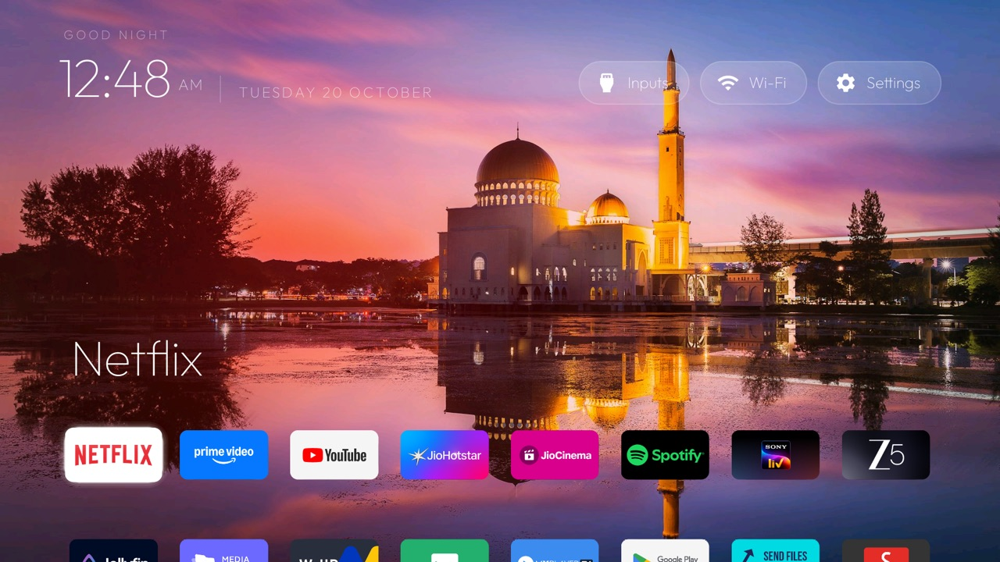
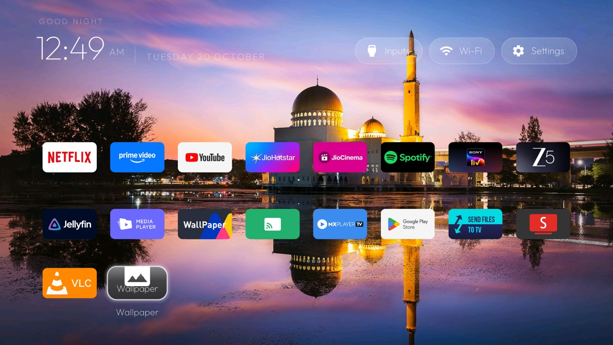
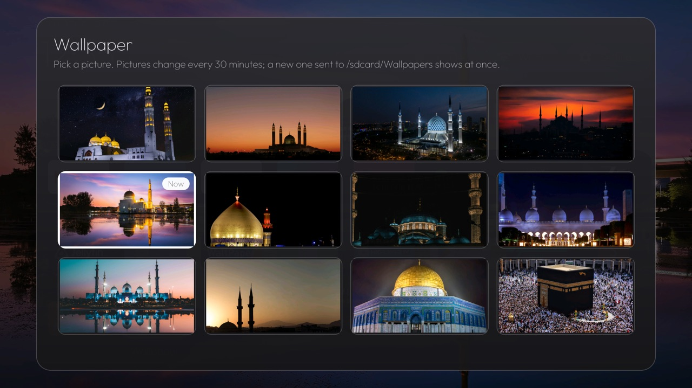
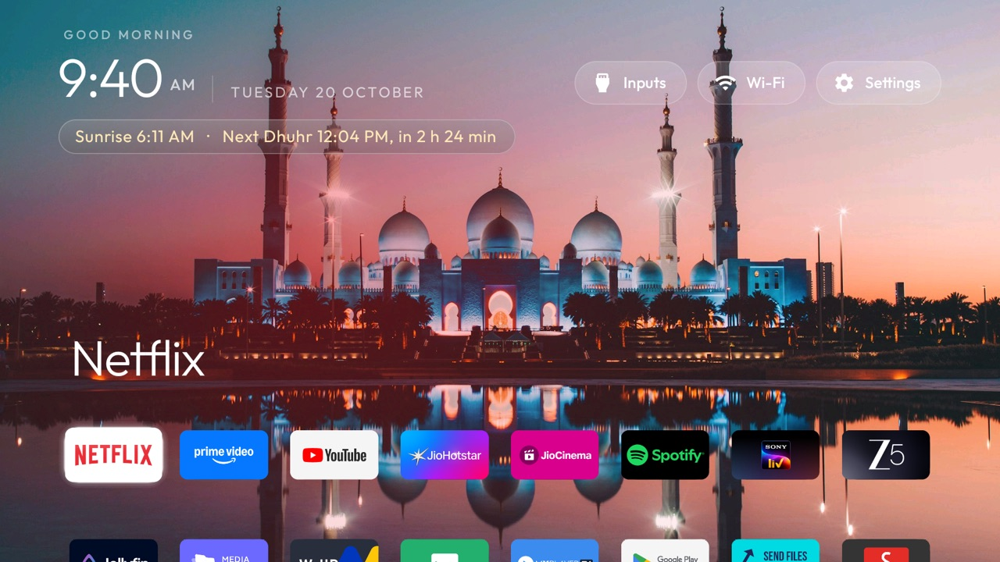
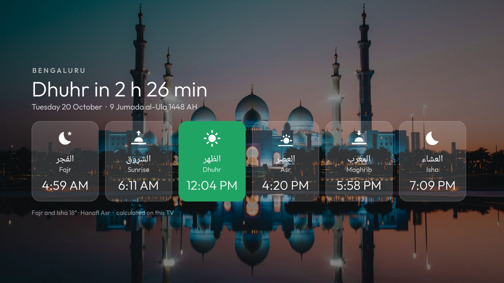
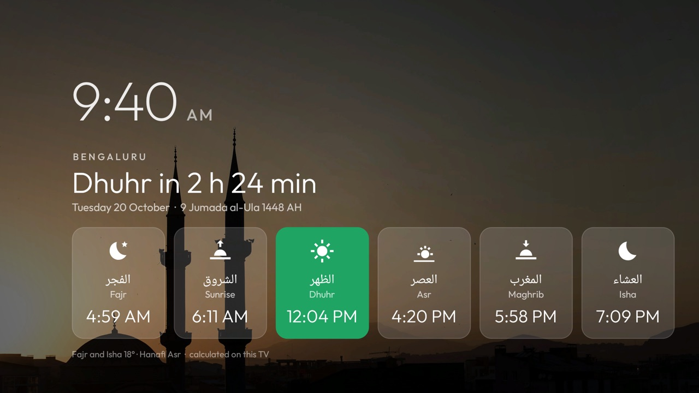

# Rotating wallpapers and a Wallpaper picker (Xiaomi MiTV-AXSO2)

This branch is the reference launcher (v2.3) with two changes for one TV, a Xiaomi MiTV-AXSO2
(dangalUHD, Android TV 9, firmware PI.6432, 2 GB RAM). The debloat list for that TV is
[`examples/xiaomi-mitv-axso2`](https://github.com/Alafazam/cleanyourtv/blob/examples-xiaomi-mitv-axso2/examples/xiaomi-mitv-axso2/debloat.txt)
(sent upstream as its own PR).

| Home | Wallpaper tile | Wallpaper pop-up |
|---|---|---|
|  |  |  |

| Prayer line on Home | Prayer Times page | Screensaver |
|---|---|---|
|  |  |  |

## What it changes

1. **Rotating wallpaper folder.** Pictures in `/sdcard/Wallpapers` (`.jpg`, `.jpeg`, `.png`, `.webp`) show
   behind Home and change every 30 minutes while Home is open, in file-name order. A picture added to the
   folder (with `adb push`, or from a phone with a file-transfer app; the phone path is not tested yet)
   shows at once and then joins the rotation.
   When the folder is empty, a theme's `wallpaper.jpg` shows as before.
2. **Wallpaper tile and pop-up.** A Wallpaper tile at the end of the app grid opens a pop-up with the
   thumbnails. OK on one makes it the wallpaper and restarts the 30 minutes. Back closes it.
3. **Photo screensaver.** The Clock screensaver shows the same pictures behind the drifting clock and date,
   under a dark veil, starting with the one after the current wallpaper and changing every 2 minutes. With an
   empty folder or `dream_photos` false it is the plain clock over the glow. Pick "Clock" under Settings →
   Device Preferences → Screen saver, or
   `adb shell settings put secure screensaver_components com.gathin.tvhome/.ClockDream`.
4. **Prayer times, calculated on the TV.** No network: the sun-position method used by most timetables, set to
   Bengaluru, Karachi method (Fajr and Isha 18°) and Hanafi Asr, checked against published Bengaluru times to
   within a minute (`PrayerTimesTest`). Home shows the current and next prayer with a countdown in a glass pill;
   a Prayer Times tile opens the full day (six cards, next one highlighted, Hijri date); the Clock screensaver
   shows the same view under the clock. Settings: `prayer_*`, `hijri_offset_days`, `dream_prayer`.
5. **Personal config.** An eight-app dock (Netflix, Prime Video, YouTube, JioHotstar, JioCinema, Spotify,
   SonyLIV, Zee5) in one row with `columns` 8, `com.android.tv` as the Live TV app, and no dark band
   behind the dock (`dock_band` false), so the dock sits on the wallpaper like the grid rows.

Settings in `launcher/app/src/main/res/values/config.xml`, also accepted in a theme's `config.json`:

| Key | Default here | Meaning |
|---|---|---|
| `wallpaper_folder` | `/sdcard/Wallpapers` | Folder of pictures; empty turns the feature and the tile off |
| `wallpaper_rotate_minutes` | `30` | Minutes between changes; `0` never rotates (a new picture still shows) |
| `dock_band` | `false` | The darker rounded band behind the dock row; the reference launcher always draws it |
| `dream_photos` | `true` | Folder pictures behind the clock in the Clock screensaver |
| `dream_photo_minutes` | `2` | Minutes each picture stays in the screensaver |

## How it works

- `WallpaperRotation` holds the rules and has no Android code, so it is unit-tested on the JVM
  (`WallpaperRotationTest`): newest picture first, then the next by name after the interval, a deleted
  picture falls back to the first, a clock that goes back restarts the interval.
- `WallpaperFolder` lists the folder and keeps the state in shared preferences, for Home and the pop-up.
- Home checks on resume and on the clock's existing one-minute tick. No new timer, thread or service.
- The wallpaper view is reused and the old bitmap released, so a rotation never holds two. The pop-up
  decodes its thumbnails at about 400 px wide on one background thread.

## Differences from the reference launcher's rules

- It adds `READ_EXTERNAL_STORAGE`, granted by `build-and-install.sh`, to read `/sdcard/Wallpapers`.
- New strings are in English only.

For a photo background in the reference launcher, see
[Gathin23/cleanyourtv#174](https://github.com/Gathin23/cleanyourtv/pull/174) (Gallery, off by default).

## Build and use

```bash
TV_HOST=<tv ip> launcher/build-and-install.sh
adb -s <tv ip>:5555 shell mkdir -p /sdcard/Wallpapers
adb -s <tv ip>:5555 push my-picture.jpg /sdcard/Wallpapers/
```

## Photos in the screenshots

Free photos from [Unsplash](https://unsplash.com) (Unsplash License). The photos themselves are not in this branch.

| # | Photo | By |
|---|---|---|
| 1 | white and gold dome building under starry night | [Katerina Kerdi](https://unsplash.com/photos/TAfqq1B3-2s) |
| 2 | silhouette of building during sunset | [AHMED](https://unsplash.com/photos/lZOGde6okcA) |
| 3 | a night view of a large building with two towers | [Firdouss Ross](https://unsplash.com/photos/wpmAydh_efA) |
| 4 | a sunset view of a large building with many spires | [Safi Noorzai](https://unsplash.com/photos/bTqiAPbaXKc) |
| 5 | white dome building near body of water during sunset | [Esmonde Yong](https://unsplash.com/photos/7_COgbItdkQ) |
| 6 | a large white building with a red light on top of it | [أخٌ في الله](https://unsplash.com/photos/nWdmDVcW9Vs) |
| 7 | a building with a blue dome lit up at night | [Büşra Salkım](https://unsplash.com/photos/P_2FuTjXJ2Q) |
| 8 | a large white building with a fountain in front of it | [Hassan Pasha](https://unsplash.com/photos/pbUGlzcRB44) |
| 9 | Sheikh Zayed Grand Mosque reflected in a pool | [David Rodrigo](https://unsplash.com/photos/kZ1zThg6G40) |
| 10 | two mosque minarets under calm sky | [Ali Arif Soydaş](https://unsplash.com/photos/uwzPks8CE3k) |
| 11 | Dome of the Rock | [Faruk Kaymak](https://unsplash.com/photos/1vriQZ8y9X8) |
| 12 | Kaaba, Mecca | [Haidan](https://unsplash.com/photos/8Kg-2kK97Xc) |
